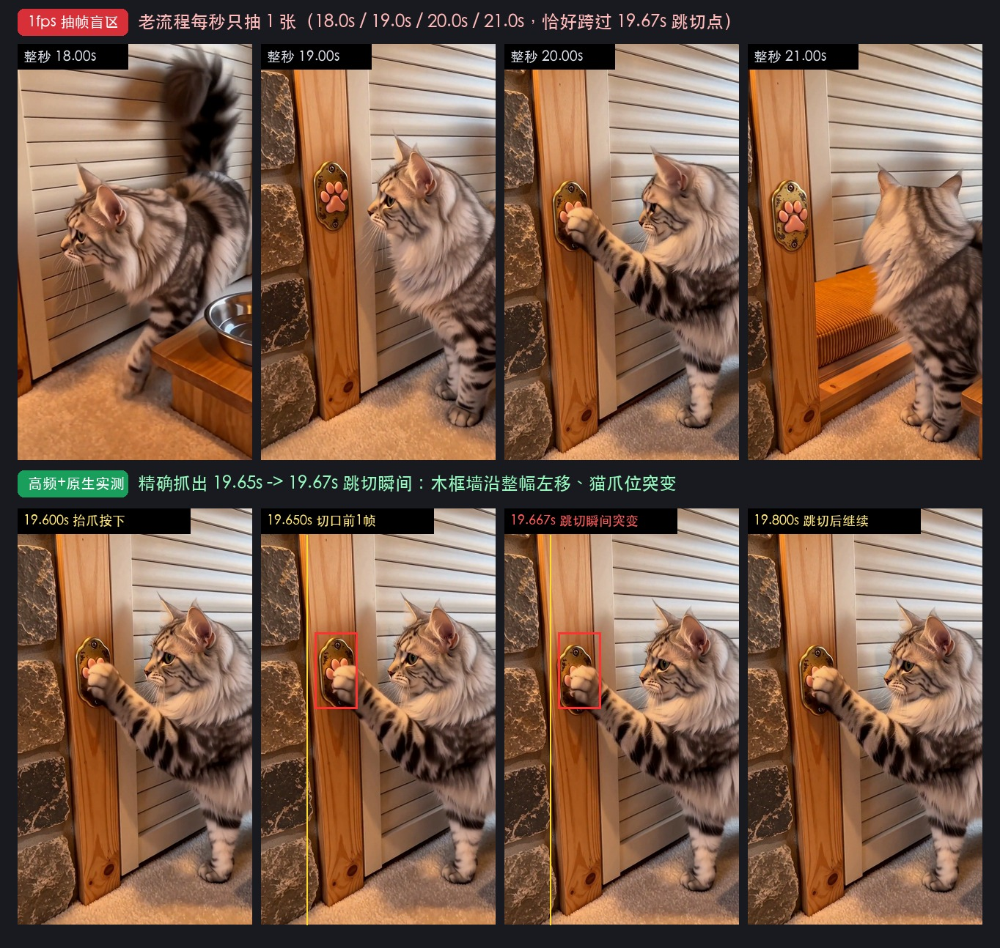
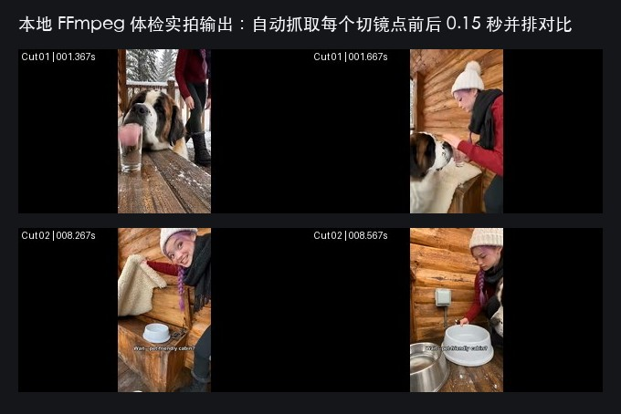
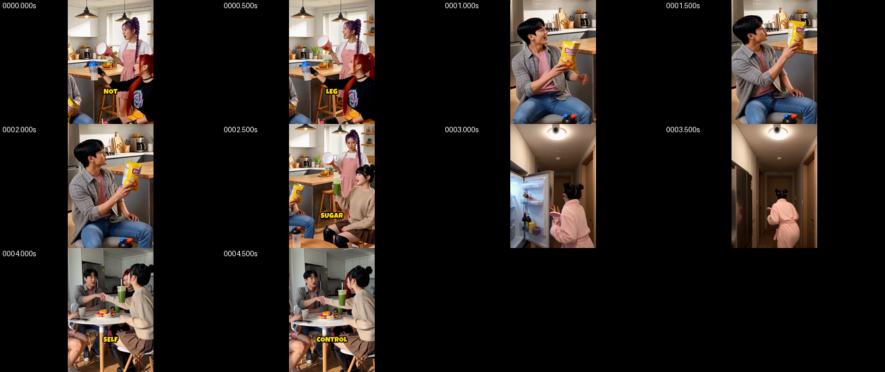

# Video QA Microscope Lite — AI 视频 0.1 秒体检显微镜

做 AI 短视频最头疼的两件事：**生成前提示词一不留神就穿模（紧闭门直接穿过去、静音镜头乱张嘴），生成后抽 1fps 截图又根本看不出 0.1 秒级跳帧和片尾废帧。**

这是我日常跑通多条 AI 短视频管线时抽出来的 **本地免费质检前置工具（开源 Lite 版）**。不调任何付费多模态 API，纯靠本地 `ffmpeg` + `Pillow` 跑毫秒级硬证据。

---

## 核心能力（0 API 费用）

1. **视频 0.1 秒级体检（`scripts/video_microscope.py`）**
   - **`--mode reference`（对标拆片）**：自动识别全部硬切秒数、黑场字卡区间、100ms 级别声音炸响/骤降卡点，输出每个切点前后 `±0.15s` 的并排拼图 `transition_pairs/cut_XX.jpg` 与 5 色阶色板。
   - **`--mode qa`（成片排雷）**：输出默认 2fps（可设 4fps/6fps）带精确秒数角标的密集连环画 `dense_sheet.png`，自动扫描片尾多余废帧并给出安全裁切时间点 `suggested_safe_out_sec`。
2. **提示词 3 条通用物理预检（`scripts/prompt_physics_lint.py`）**
   - **紧闭门穿墙拦截**（`closed_door_ghosting`）：同拍里没写预开/半开且无硬切时，拦截“推开紧闭门并直接穿过”。
   - **静音镜头禁带台词**（`silent_quoted_dialogue`）：写了无声口型/默念却同拍出现引号或 `<d>` 台词直接报错拦截，防止 AI 乱动嘴。
   - **英文语速上限预警**（`english_speech_rate_high`）：扣除句尾 `0.8s` 留白后，超过 `2.4 词/秒` 自动警告。

---

## 30 秒安装与运行

```bash
# 1. 准备依赖（Python 3.9+）
pip install pillow
brew install ffmpeg   # macOS；Linux 请用 apt install ffmpeg

# 2. 对标视频拆解（切镜点 + 音峰 + 切镜前后对比图）
python3 scripts/video_microscope.py reference.mp4 --mode reference --out ./probe_ref

# 3. AI 成片质检（2fps 密集连环画 + 片尾废帧预警）
python3 scripts/video_microscope.py output.mp4 --mode qa --fps 2 --out ./probe_qa

# 4. 提示词生成前预检
python3 scripts/prompt_physics_lint.py --duration 10 --prompt "He opens the closed door and walks through it."
```

> **使用与维护说明**：本仓库为作者个人实战抽取的开源 Lite 脚本，按 MIT/自用协议免费提供，**不提供一对一装机指导或私聊技术答疑**。

---

## 实测效果对比（Real Examples）

### 1. 为什么不能只靠 1fps 截图审 AI 视频？
常规工具每秒只抽 1 张整秒图（`18.0s / 19.0s / 20.0s / 21.0s`），会恰好跨过持续仅几百毫秒的跳帧突变；加密抓帧后可以直接把 `19.650s → 19.667s` 整幅画面瞬间左移的穿帮钉死：



### 2. `--mode reference`：对标片切镜前后 `±0.15s` 并排体检
自动扫描硬切秒数与 `100ms` 音量突变点，把每个切口前 `0.15s` 与后 `0.15s` 并排拼图，转场衔接一目了然（下图为工具切点对比排版实拍输出）：



对 2.4 秒实测样片运行 `--mode reference` 输出的结构化 `summary.json` 示例（耗时秒级，0 模型 API 费用）：

```json
{
  "status": "ok",
  "mode": "reference",
  "media": { "width": 540, "height": 960, "fps": 30.0, "duration_sec": 2.4 },
  "detected_cuts_sec": [1.0],
  "transition_pairs": [
    { "cut_sec": 1.0, "before_sec": 0.866667, "after_sec": 1.166667, "path": "transition_pairs/cut_01.jpg" }
  ],
  "audio": {
    "has_audio": true,
    "top_transient_peaks": [
      { "time_sec": 1.8, "level_db": -7.7, "jump_db": 18.46 },
      { "time_sec": 0.9, "level_db": -16.95, "jump_db": 9.69 }
    ]
  },
  "palette_5hex": ["#2A1A16", "#704133", "#916A51", "#AF876D", "#D1BCAE"]
}
```

### 3. `--mode qa`：成片毫秒级角标密集连环画
对 5 秒 AI 短剧翻车片段运行 `--mode qa --fps 2` 的真实输出 `dense_sheet.png`：一眼看穿 `0000.500s` 红发女生在 `0002.500s` 切成黑发女生、以及 `0004.500s` 握手时绿色果昔杯半空悬浮：



---

## Lite 开源版 vs 飞书永久买断知识库 Pro 版

| 模块 | 开源 Lite 版（本仓库免费） | 飞书永久买断知识库 Pro 版（早鸟 ¥399） |
|---|---|---|
| FFmpeg 0.1s 切镜/音峰扫描 & 密集拼图 | ✅ 完整可用 | ✅ 完整可用 |
| 通用物理防穿模静态检查 | ✅ 基础 3 条（门穿墙 / 静音台词 / 语速） | ✅ 完整 6 条 + **H3 专属语法校验**（单切点/标签标点/纯光学词） |
| 原生视频模型审片提示词与改造实录 | — | ✅ **Gemini 4 原生看片两步法完整实录**（含实片踩坑对照） |
| 上游导演与多平台变现体系 | — | ✅ 短剧多硬切导演 Skill + 实证写作 Skill + YouTube 运营 2.0 + 107 篇知识库 MCP |

如果你不仅需要质检脚本，还想直接抄整套 **「AI 拆片 → 分镜生成 → 原生看片质检 → 账号矩运营」** 的闭环实操笔记与 Pro 工具包，当前飞书永久买断库早鸟价 **¥399**（限前 50 名，满额逐步上调至 ¥499 / ¥599）：

👉 **了解与开通入口**：https://vcn55ni4prkd.feishu.cn/docx/ScDEdsnsyoqPGqxjPiEcaQ34nHg
